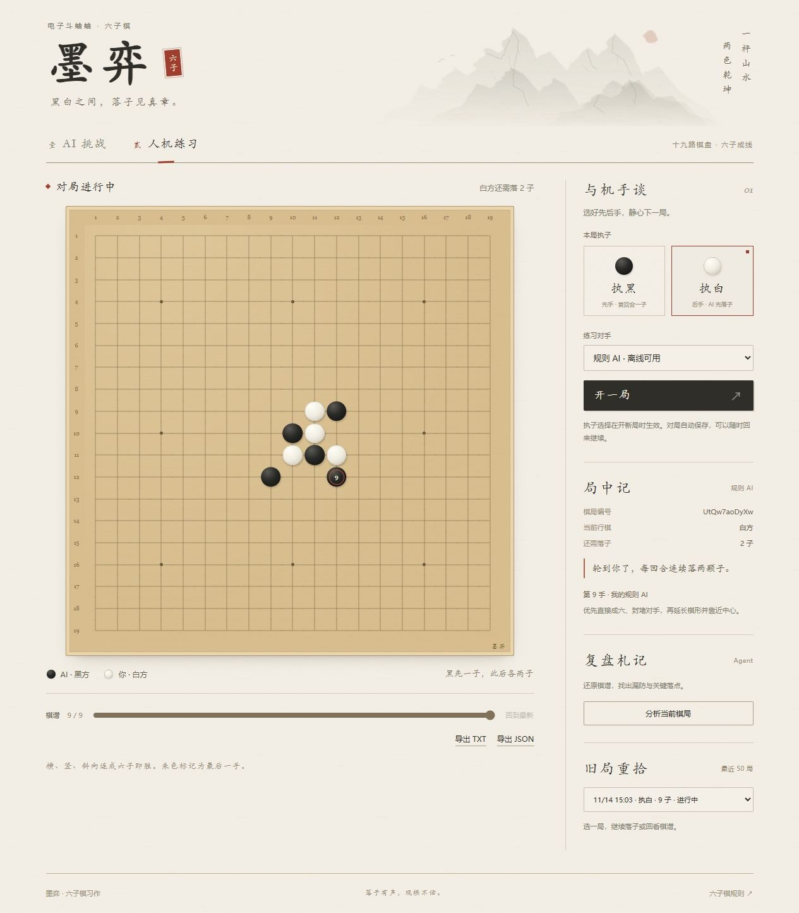

# 六子棋

[](https://github.com/zhehong268/liuziqi/actions/workflows/check.yml)

“电子斗蛐蛐”任务 2 的六子棋 Web 应用。上传自己的 Python 或 C++ AI，挑战网站官方版，也可以自选先后手进行人机练习。对局有逐子记录、赛后复盘和棋谱导出。后端用 Flask 和 SQLite，前端是原生 JavaScript。

[在线练习](https://zhehong268.github.io/liuziqi/) · [下载 Windows 客户端](https://github.com/zhehong268/liuziqi/releases/latest)

网页版直接打开就能下棋，支持先后手选择、复盘和 TXT / JSON 棋谱导出，记录保存在当前浏览器。上传 Python / C++ AI 对战请下载客户端，在自己的电脑上运行。



## Windows 客户端

下载 Release 中的 `MoYi-Setup-Windows-x64.exe` 安装，或解压便携版后运行 `MoYi.exe`。程序会自动打开本机网页，不需要另装 Python，也不用填 API Key。

上传 AI 前，先安装并启动 [Docker Desktop](https://www.docker.com/products/docker-desktop/)，使用 Linux 容器，再点启动窗口的“准备对战环境”。环境就绪后即可上传源码、选择先后手，挑战官方版。人机练习不需要 Docker。

对局数据保存在 `%LOCALAPPDATA%\MoYi\data`，更新和卸载程序会保留这些记录。关闭启动窗口就会停止本机服务。具体步骤见 [Windows 客户端](docs/Windows客户端.md)。

## 运行

需要 Python 3.10 或以上版本；AI 挑战还需要 Docker Desktop，切换到 Linux 容器。下面是 Windows PowerShell 的启动命令：

```powershell
git clone https://github.com/zhehong268/liuziqi.git
cd liuziqi
python -m venv .venv
.\.venv\Scripts\python.exe -m pip install -r requirements.txt
docker build -t connect6-sandbox:1 sandbox
.\.venv\Scripts\python.exe app.py
```

打开 [http://127.0.0.1:5000](http://127.0.0.1:5000)。不需要 API Key。后续启动只需运行最后一条命令，按 `Ctrl+C` 停止。Docker 不可用时仍可使用人机练习。

## AI 挑战

1. 填写 AI 名称，上传 UTF-8 编码的单文件 `.py` 或 `.cpp` 源码，最大 512 KB。
2. 选择执黑或执白，点击“开始挑战”。C++ 使用 `g++ -std=c++17 -O2 -pipe` 编译。
3. 双方自动落子，页面显示当前思考时间。结束后可看复盘、拖动棋谱或导出。

双方按 `arena.v1` 协议逐行读 stdin、写 stdout，每次返回一颗子。页面提供可下载的 `bot.py` 示例，完整接入方法见 [上传 AI 与对战](docs/上传AI与对战.md)。Python 暂只支持标准库，C++ 暂只支持标准库和单文件。

官方引擎在 `official/main.cpp`，来自 `C6_package_20261106/src/main.cpp` 最终版，原算法未改动。它有双子搜索和跨请求规划，与人机练习中的简单规则 AI 分开运行。

每颗子最多思考 **10 秒**，双方均为 **单线程**。运行容器使用 `--pids-limit 1` 限制线程和子进程，并限制为 1 个 CPU；超时会终止容器，崩溃、无效响应或非法落子判负。源码编译也在独立容器中进行。没有 Docker 时不会直接在本机执行上传代码。

## 玩法

19×19 棋盘，黑先。黑方首回合下一颗，之后双方每回合各下两颗。横、竖或斜向连成六颗及以上获胜，棋盘下满和棋。第一颗已经成六时立即结束，不用补第二颗。

进入“人机练习”，选择执黑或执白，再点“开一局”。执黑由你先落一颗；执白由 AI 自动开局，随后轮到你连续落两颗。刷新、历史恢复和复盘都会保留本局执子。修改选项只影响新局。

页面用素纸墨线棋盘和淡青绿山水背景，规则、上传表单与对局详情按需展开。背景素材出处见 [界面参考](docs/界面参考.md)。两种模式都可以：

- 自动保存对局，刷新后接着下。
- 历史列表只显示已结束的对局；进行中的棋局刷新后继续。
- 分析当前棋局，终局后自动复盘。
- 拖动滑块回放棋谱，回到最新位置继续落子。
- 下载 TXT 或 JSON 棋谱。

## AI 和复盘

人机练习和上传示例的算法在 `bot.py` 的 `choose_ai_move(board, player)` 中。先找直接成六的落点，再封堵对手，剩下的位置按连线和中心距离评分。

要改自己的参赛策略，可以修改这个文件后从网页上传，新上传会作为新版本保留。

复盘 Agent 在 `agent.py` 中：读取棋谱，逐颗还原局面，检查挑战方落完一回合后，对手是否能用一颗或两颗子成六，记录手数、威胁位置和练习建议。超时和非法落子的判负原因也会写入分析。

复盘只检查当前回合的成六威胁，没有完整搜索多回合战术。代码中保留了可选的外部模型接口，配置方法见 [AI 接入说明](docs/第02课-AI接入.md)。

## 目录

```text
app.py                 Flask 接口、数据库和棋谱导出
bot.py                 棋规、下棋算法、平台协议入口
agent.py               复盘分析和可选模型接口
arena.py               上传管理、后台对战队列和裁判
sandbox_runner.py      容器编译、协议通信和超时处理
official/main.cpp      网站官方 AI 源码
sandbox/               对战镜像和单线程启动器
static/                HTML、CSS、JavaScript
web/                   浏览器版棋规、AI 和 IndexedDB 存储
desktop.py             Windows 启动窗口和打包自检
packaging/             安装包和便携版构建脚本
scripts/build_pages.py  生成 GitHub Pages 静态网站
data/connect6.db        启动时生成的数据库
tests/                 规则、API、裁判和真实容器测试
docs/                  开发说明
```

数据库中的 `games` 保存棋局，`moves` 保存每颗落子和耗时，`analyses` 保存复盘，`submissions` 和 `arena_matches` 保存上传版本与挑战结果。上传文件和编译缓存放在 `data/arena/`，不提交到 Git。

## 平台提交

到[学生客户端](http://139.196.148.174/client)选择六子棋、Python 3，上传根目录的 `bot.py`。

`bot.py` 只用 Python 标准库。它按 `arena.v1` 协议读取 stdin、输出 stdout，每次请求返回一颗子，单次决策限时 10 秒。平台所需的 Docker 配置和完整协议见 [平台提交说明](docs/平台规则与提交.md)。

目前已做本地协议测试，正式评测还没跑。导出的 TXT / JSON 是本项目自己的格式，暂时不能直接用于平台回放。

## 测试

```powershell
.\.venv\Scripts\python.exe -m unittest discover -s tests -v
```

验证真实容器的 10 秒超时、线程限制、Python/C++ 运行和错误响应：

```powershell
$env:ARENA_DOCKER_TESTS = '1'
.\.venv\Scripts\python.exe -m unittest discover -s tests -v
```

前端改动还可以用 `node --check static/app.js` 检查语法。Node.js 只用于检查，启动应用不需要它。推送后会运行 GitHub Actions，结果在 [Actions](https://github.com/zhehong268/liuziqi/actions) 查看。

浏览器版用 `node --test tests/browser.test.cjs` 检查棋规和复盘，再执行 `python scripts/build_pages.py`，产物在 `dist/pages/`。推送相关改动到 main 后自动发布网站；推送 `v*` 标签后自动构建、自检并发布 Windows 下载文件。

## 开发文档

- [后端与数据库](docs/第01课-需求与架构.md)
- [AI 接入](docs/第02课-AI接入.md)
- [接口说明](docs/接口说明.md)
- [上传 AI 与对战](docs/上传AI与对战.md)
- [Git 提交与推送](docs/GitHub首次推送.md)
- [迭代日志](docs/迭代日志.md)
- [更新记录](CHANGELOG.md)
