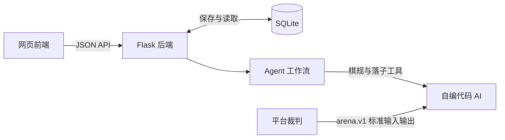

# liuziqi · 六子棋 Agent 对弈室

[](https://github.com/zhehong268/liuziqi/actions/workflows/check.yml)

“电子斗蛐蛐”任务 2 的六子棋 Web Demo，使用 **Python、Flask、SQLite 和原生 JavaScript** 实现人机对战、对局保存、Agent 复盘与棋谱导出。

**默认使用自己编写的纯代码 AI，对战与本地复盘均不需要 API Key。** 同一份下棋算法既能在网页中试玩，也能以单个 `bot.py` 文件提交到竞赛平台。

项目仓库：[zhehong268/liuziqi](https://github.com/zhehong268/liuziqi) · 当前版本：`v0.1` 教学 Demo

## 功能一览

| 功能 | 当前实现 |
| --- | --- |
| 人机对战 | 用户执黑，自己的规则 AI 执白，自动处理双子回合 |
| 六子棋规则 | 19×19 棋盘、回合校验、非法落子拒绝、六连或以上立即判胜 |
| 数据库存储 | SQLite 保存棋局、逐颗落子、AI 决策来源和复盘结果 |
| 刷新恢复 | 恢复同一棋局，可选择最近 50 局继续查看 |
| Agent 复盘 | 重建局面、检查直接漏防，输出问题手数、改进建议和执行步骤 |
| 终局分析 | 对战结束自动复盘，进行中也可手动分析 |
| 棋谱回放 | 拖动滑块逐颗查看，回到最新局面后继续下棋 |
| 棋谱导出 | TXT 方便阅读，JSON 保存结构化棋谱 |
| 平台适配 | `bot.py` 支持 `arena.v1` JSON Lines 协议，仅依赖标准库 |
| 持续检查 | GitHub Actions 在 push / pull request 后检查测试和 JavaScript 语法 |

## 快速开始

以下命令使用 Windows PowerShell，需要安装 **Python 3.10 或以上版本**和 Git。

```powershell
git clone https://github.com/zhehong268/liuziqi.git
cd liuziqi

python -m venv .venv
.\.venv\Scripts\python.exe -m pip install -r requirements.txt
.\.venv\Scripts\python.exe app.py
```

本机已有项目位于 `D:\计协学习\connect6-agent-demo` 时，直接进入该目录启动：

```powershell
cd D:\计协学习\connect6-agent-demo
.\.venv\Scripts\python.exe app.py
```

浏览器打开 **[http://127.0.0.1:5000](http://127.0.0.1:5000)**，选择“我的规则 AI · 离线”即可开始。默认配置无需填写 `.env`。

保持后端终端运行；按 `Ctrl+C` 停止。数据库在首次启动时自动创建，重新启动后已有棋局仍会保留。上述命令直接使用虚拟环境解释器，无需先激活 PowerShell 脚本。

### 演示顺序

1. 新建棋局，黑方首回合落一颗，观察白方自动落两颗。
2. 黑方连续落完本回合两颗，继续人机对战。
3. 刷新页面，确认棋局编号和棋子恢复。
4. 点击“分析当前棋局”，查看建议和 Agent 执行过程；终局时会自动分析。
5. 拖动“棋谱回放”滑块查看历史落子，点击“回到最新”继续对局。
6. 下载 TXT / JSON 棋谱，再查看 GitHub 上的提交记录。

## 棋规

- 棋盘为 **19×19**，黑方先手。
- 黑方首回合下 **1 子**，之后双方每回合各下 **2 子**。
- 横、竖、两个斜向，任意方向形成 **6 子或以上**连线立即获胜。
- 本回合第一颗已经获胜时立即结束，不再下第二颗。
- 棋盘下满且无人获胜时为和棋；无 PASS、禁手和认输动作。
- 一颗子对应一次决策，回合所需的两颗子按顺序分别处理。

规则依据：[平台六子棋赛道](http://139.196.148.174/connect6)。核对日期为 2026-11-14，详细记录见 [平台规则与提交](docs/平台规则与提交.md)。

## 项目结构与技术栈

```text
liuziqi/
├── app.py                      Flask 路由、规则校验、事务与棋谱导出
├── bot.py                      棋规、自编 AI、平台 stdin/stdout 入口
├── agent.py                    复盘工作流、落点校验、可选外部模型适配
├── static/
│   ├── index.html              页面结构
│   ├── styles.css              棋盘与页面样式
│   └── app.js                  落子、恢复、回放与复盘交互
├── data/connect6.db             运行后生成的 SQLite 数据库，Git 忽略
├── tests/test_demo.py           核心规则、API、Agent 和平台协议测试
├── docs/                       教学、平台协议、验收与迭代记录
├── .github/workflows/check.yml  GitHub Actions 自动检查
├── .env.example                可选配置示例
├── requirements.txt            Web 应用依赖
└── CHANGELOG.md                版本更新记录
```



前端显示棋盘并发起请求；后端校验回合与合法落点、判定胜负并保存数据。下棋策略集中在 `bot.py`，复盘流程位于 `agent.py`。

## AI 和 Agent 怎样工作

### 自编下棋 AI

入口为 `bot.py` 中的 `choose_ai_move(board, player)`。当前策略依次尝试：

1. 找到自己下一颗可以直接成六的位置。
2. 封堵对手下一颗可以直接成六的位置。
3. 根据己方连线、对手连线、邻居数量和中心距离评分，选择合法空位。

接入自己的策略时，保持以下约定：

| 输入 / 输出 | 约定 |
| --- | --- |
| `board` | 19×19 二维列表，空位为 `None`，棋子为 `"black"` / `"white"` |
| `player` | 当前执棋颜色，应同时兼容黑方和白方 |
| 返回值 | `(row, col)`，两个 0～18 的整数，必须对应空位 |
| 决策单位 | 每次返回一颗子，两颗子的调度交给后端或平台裁判 |

平台的 `0 / 1 / 2` 棋盘由 `decide()` 转换。Web 与平台共用策略函数：修改评分或搜索逻辑、重启后端试玩、验证后重新上传 `bot.py`，即可完成一次迭代。

### 本地复盘 Agent

本版采用固定工作流：

**读取数据库棋谱 → 逐颗重建棋盘 → 调用直接威胁检测工具 → 生成结构化建议 → 保存复盘。**

Agent 重点评估用户执黑的表现，在黑方完整回合结束后检查白方可直接成六的落点，避免把双子回合中间状态误判为最终漏防。输出包括：

- `summary`：棋局概况。
- `keyMistakes`：具体手数、问题和改进建议。
- `strengths`：本次检测能够支持的正面观察。
- `nextPractice`：下一局可尝试的练习。
- `trace`：本次工作流执行步骤。

复盘与落子数量关联，刷新后可恢复；继续落子后可以生成新的复盘。同一棋谱会复用已有结果。

<details>
<summary>可选扩展：外部模型辅助下棋与复盘</summary>

外部模型适配默认关闭，不属于平台提交依赖。需要体验时，可复制 `.env.example` 为 `.env`，填写自己账号可调用的服务配置并重启后端。完整配置、接口选择、合法性校验和失败回退见 [AI 与 Agent 接入教程](docs/第02课-AI接入.md)。

此扩展可能向所配置服务发送棋盘和棋谱并产生服务费用。真实 Key 仅放后端，不能提交 GitHub。当前只验证过模拟返回值路径，尚未进行真实外部服务调用。

</details>

## 提交到竞赛平台

在[学生客户端页面](http://139.196.148.174/client)下载客户端，按其运行要求准备 Docker Desktop，登录自己的平台账号：

1. 选择 **六子棋 / Python 3**。
2. 上传本项目根目录的 **`bot.py`**。
3. 填写版本备注，例如“v0.1：直接成六优先、封堵与连线评分”。
4. 开始评测，由客户端执行两局、交换先后手，并向服务器提交棋谱校验。

`bot.py` 只使用 Python 标准库，无需 Flask、数据库、第三方模型服务或 API Key。它持续读取 stdin，每条 `move_request` 对应一条 `move_response`，原样回显 `request_id`，每次仅返回一个 `PLACE` 动作。

平台单次决策硬超时为 **10,000 ms**，stdout 只能输出单行协议 JSON；日志应写 stderr。代码修改后需要重新上传版本。

当前已通过本地协议测试，尚未登录客户端完成正式评测。Demo 的 TXT / JSON 为自定义棋谱格式，暂未适配平台回放器。更多约定见 [平台规则与提交](docs/平台规则与提交.md)。

## 数据库与接口

| 数据表 | 保存内容 |
| --- | --- |
| `games` | 棋局编号、状态、胜者、创建时间和对手类型 |
| `moves` | 逐颗落子顺序、颜色、坐标、AI 来源与原因 |
| `analyses` | 按棋局与落子数量关联的复盘结果 |

数据库文件位于 `data/connect6.db`，由后端自动维护，不提交到 Git。棋盘可从逐颗棋谱重建。

| 方法 | 路径 | 说明 |
| --- | --- | --- |
| GET | `/api/health` | 后端状态 |
| GET | `/api/games` | 最近 50 局 |
| POST | `/api/games` | 新建棋局，默认对手为本地 AI |
| GET | `/api/games/<id>` | 获取棋盘、棋谱与对应复盘 |
| POST | `/api/games/<id>/moves` | 黑方落一颗，JSON 为 `{"row":9,"col":9}` |
| POST | `/api/games/<id>/ai-turn` | AI 完成本回合剩余落子 |
| POST | `/api/games/<id>/analysis` | 分析已保存棋谱，复用已有结果 |
| GET | `/api/games/<id>/export?format=txt` | 导出 TXT，显示坐标从 1 开始 |
| GET | `/api/games/<id>/export?format=json` | 导出 JSON，坐标从 0 开始 |

## 验证与持续集成

运行自动测试：

```powershell
.\.venv\Scripts\python.exe -m unittest discover -s tests -v
```

本地已有 **14 项测试通过**，覆盖首回合与双子回合、四方向六连与超长连线、非法输入、终局停止、数据库恢复与迁移、复盘缓存、模型扩展回退、平台常驻进程多条请求等场景。测试使用临时数据库。

安装 Node.js 后还可检查前端语法：

```powershell
node --check static/app.js
```

Node.js 只用于检查，运行 Web 应用不需要它。仓库已配置 GitHub Actions，远程检查结果以 [Actions 页面](https://github.com/zhehong268/liuziqi/actions)显示为准。

## 版本迭代

仓库保留本地功能提交与 GitHub 初始化提交的完整历史。每次尝试按“提出问题 → 修改 → 验证 → 记录结果 → 提交 → 推送”完成。

例如调整 AI 评分后，先将实际观察写入 `docs/迭代日志.md`，再执行：

```powershell
.\.venv\Scripts\python.exe -m unittest discover -s tests -v
git diff
git add bot.py docs/迭代日志.md
git commit -m "feat: 调整 AI 防守评分权重"
git push
```

提交说明描述实际改动，实验失败也可以保留真实记录。后续计划包括双子组合评估、更多固定棋局测试、在棋盘定位复盘问题和平台棋谱格式适配。

## 文档与能力边界

- [AI 与 Agent 接入教程](docs/第02课-AI接入.md)
- [平台规则与提交](docs/平台规则与提交.md)
- [GitHub 推送教程](docs/GitHub首次推送.md)
- [迭代日志](docs/迭代日志.md)
- [v0.1 验收记录](docs/v0.1验收记录.md)
- [版本更新记录](CHANGELOG.md)

这是面向学习和作业演示的本地单人 Demo。AI 为简单启发式；本地 Agent 检查直接威胁和部分布局问题，不搜索多回合战术，未发现问题不代表每步都正确。当前没有账号系统、在线匹配或公网部署，正式平台成绩仍待客户端评测。
